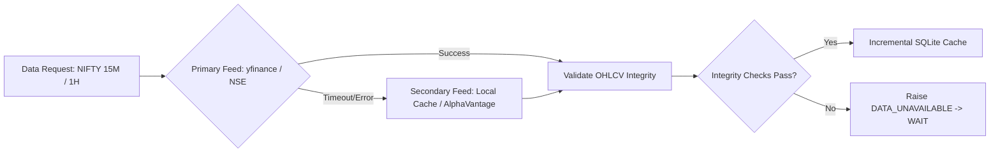

# NIFTY AUTONOMOUS TRADER — DATA ARCHITECTURE

**Document:** `docs/DATA_ARCHITECTURE.md`  
**Architecture Version:** 1.0.0 (Phase 0 Baseline)  
**Status:** Approved Data Design  

---

## 1. Provider Decoupling: Market Data vs. Broker

A fundamental design rule of this system is the **absolute separation of Market Data from Broker Execution**:

```
┌────────────────────────────────────────────────────────┐
│                   DATA ABSTRACTION                     │
├───────────────────────────┬────────────────────────────┤
│ MarketDataProvider        │ BrokerProvider             │
│ • Candle history (1H, 15M)│ • Account balance          │
│ • Real-time quotes        │ • Margin utilization       │
│ • Volatility & ATR        │ • Order execution          │
│ • Economic news feeds     │ • Position management      │
│ (Zero execution power)    │ (Zero data dependency)     │
└───────────────────────────┴────────────────────────────┘
```

By decoupling these interfaces:
1. The agent can research, observe, and paper trade using completely free, public, or local market data feeds without possessing any broker account.
2. In future phases, swapping execution brokers (e.g. from Paper Broker to DhanHQ, Zerodha, or Interactive Brokers) requires zero alterations to the observation or data engine.

---

## 2. NIFTY Market Data Ingestion Pipeline

### 2.1 Feed Resolution Hierarchy


### 2.2 Incremental Sync Algorithm
To minimize bandwidth and avoid API rate limits:
1. Query SQLite: `SELECT MAX(timestamp) FROM candles WHERE symbol='NIFTY' AND timeframe='15m'`.
2. If empty, perform an initial historical backfill (e.g., last 30 days for 15M, last 90 days for 1H).
3. If populated, fetch only candles where `timestamp > MAX(timestamp)`.
4. Discard unclosed forming candles until their period closes.

### 2.3 Data Hygiene & Anomaly Filters
Incoming candle data must pass strict sanity gates before entering the trading state machine:
- **Price Sanity:** `High >= Low`, `High >= Open`, `High >= Close`, `Low <= Open`, `Low <= Close`.
- **Zero-Value Trap:** Reject any record where `Open <= 0` or `Volume < 0`.
- **Timestamp Monotonicity:** Reject duplicate timestamps or non-chronological sequences.
- **Circuit Filter:** Flag as anomalous if single 15M candle move exceeds 4% without confirmed macro catalyst.

---

## 3. Database Schema (SQLite / WAL Mode)

The system persists all historical data, agent perceptions, and simulated transactions in an embedded, zero-maintenance SQLite database (`data/trader.db`) configured with `PRAGMA journal_mode = WAL;`.

```sql
-- 1. Candlestick Data Store
CREATE TABLE IF NOT EXISTS candles (
    id INTEGER PRIMARY KEY AUTOINCREMENT,
    symbol TEXT NOT NULL,              -- 'NIFTY'
    timeframe TEXT NOT NULL,           -- '1h', '15m'
    timestamp DATETIME NOT NULL,       -- ISO-8601 UTC
    open REAL NOT NULL,
    high REAL NOT NULL,
    low REAL NOT NULL,
    close REAL NOT NULL,
    volume REAL NOT NULL,
    is_closed BOOLEAN NOT NULL DEFAULT 1,
    UNIQUE(symbol, timeframe, timestamp)
);
CREATE INDEX IF NOT EXISTS idx_candles_lookup ON candles(symbol, timeframe, timestamp DESC);

-- 2. Structured Market Perceptions & Agent Observations
CREATE TABLE IF NOT EXISTS observations (
    id INTEGER PRIMARY KEY AUTOINCREMENT,
    timestamp DATETIME NOT NULL,
    symbol TEXT NOT NULL,
    market_regime TEXT NOT NULL,        -- 'BULLISH', 'BEARISH', 'SIDEWAYS'
    one_hour_bias TEXT NOT NULL,        -- 'BULLISH', 'BEARISH', 'NEUTRAL'
    fifteen_minute_state TEXT NOT NULL, -- 'TRENDING', 'PULLBACK', 'RANGE'
    setup_status TEXT NOT NULL,         -- 'NONE', 'DEVELOPING', 'CONFIRMED'
    action_decided TEXT NOT NULL,       -- 'WAIT', 'OBSERVE', 'WATCH_SETUP', 'TRADE_PLAN'
    important_levels JSON NOT NULL,     -- Array of support/resistance prices
    reasoning_summary TEXT NOT NULL,
    uncertainties JSON,
    raw_snapshot JSON NOT NULL          -- Full audit trail of input snapshot
);
CREATE INDEX IF NOT EXISTS idx_obs_time ON observations(timestamp DESC);

-- 3. Trade Plans (Proposed by AI, Validated by Risk Gate)
CREATE TABLE IF NOT EXISTS trade_plans (
    plan_id TEXT PRIMARY KEY,
    timestamp DATETIME NOT NULL,
    symbol TEXT NOT NULL,
    direction TEXT NOT NULL,            -- 'LONG', 'SHORT'
    timeframe TEXT NOT NULL,            -- '15m'
    setup_name TEXT NOT NULL,           -- '20EMA_PULLBACK', 'RANGE_BREAKOUT'
    planned_entry REAL NOT NULL,
    planned_stop_loss REAL NOT NULL,
    planned_target REAL NOT NULL,
    risk_reward_ratio REAL NOT NULL,
    risk_gate_status TEXT NOT NULL,     -- 'APPROVED', 'REJECTED'
    rejection_reason TEXT
);

-- 4. Simulated Paper Orders
CREATE TABLE IF NOT EXISTS paper_orders (
    order_id TEXT PRIMARY KEY,
    plan_id TEXT REFERENCES trade_plans(plan_id),
    timestamp DATETIME NOT NULL,
    symbol TEXT NOT NULL,
    side TEXT NOT NULL,                 -- 'BUY', 'SELL'
    order_type TEXT NOT NULL,           -- 'MARKET', 'LIMIT'
    quantity INTEGER NOT NULL,
    requested_price REAL NOT NULL,
    filled_price REAL,
    slippage REAL DEFAULT 0.0,
    status TEXT NOT NULL,               -- 'PENDING', 'FILLED', 'CANCELLED', 'REJECTED'
    filled_time DATETIME
);

-- 5. Active & Historical Paper Positions
CREATE TABLE IF NOT EXISTS paper_positions (
    position_id TEXT PRIMARY KEY,
    order_id TEXT REFERENCES paper_orders(order_id),
    symbol TEXT NOT NULL,
    direction TEXT NOT NULL,            -- 'LONG', 'SHORT'
    quantity INTEGER NOT NULL,
    entry_price REAL NOT NULL,
    entry_time DATETIME NOT NULL,
    current_price REAL,
    trailing_stop_loss REAL NOT NULL,
    target_price REAL NOT NULL,
    exit_price REAL,
    exit_time DATETIME,
    realized_pnl REAL,
    pnl_percentage REAL,
    exit_reason TEXT,                   -- 'TARGET_HIT', 'STOP_HIT', 'TIME_STOP', 'MANUAL'
    status TEXT NOT NULL                -- 'OPEN', 'CLOSED'
);
```

---

## 4. Off-Market, Weekend & Holiday Handling

1. **Exchange Calendar Awareness:**
   - Pre-populated with the official **NSE Trading Holiday Calendar** (Republic Day, Diwali, Eid, Christmas, etc.).
   - Automatically transitions to `MARKET_CLOSED` on weekends (Saturday, Sunday) and declared exchange holidays.
2. **Offline Simulation Mode:**
   - For testing, backtesting, and development during weekends or evening hours, the Data Provider supports a `--replay-date <YYYY-MM-DD>` flag.
   - Replays historical 15M candles minute-by-minute or candle-by-candle through the same event loop without altering production code.
