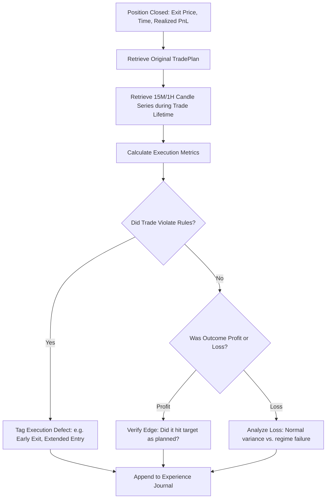

# NIFTY AUTONOMOUS TRADER — LEARNING & SELF-IMPROVEMENT ARCHITECTURE

**Document:** `docs/LEARNING_ARCHITECTURE.md`  
**Architecture Version:** 1.0.0 (Phase 0 Baseline)  
**Status:** Approved Learning Design  

---

## 1. The Core Philosophy of Trading Self-Improvement

In financial markets, unconstrained self-modifying algorithms are catastrophic. When an AI agent autonomously tweaks its trading rules after every loss, it inevitably falls into **recency bias, overfitting, and catastrophic drawdowns**.

Therefore, the NIFTY Autonomous Trader operates under an uncompromising principle:

> **NO SILENT OR AUTONOMOUS CODE/STRATEGY MODIFICATIONS ON LIVE OR ACTIVE PAPER SESSIONS.**

Self-improvement in this software is modeled after the rigorous scientific discipline of an institutional quantitative trading firm:
```
  TRADE OUTCOME
       ↓
  POST-MORTEM (Detailed Root-Cause Analysis)
       ↓
  LESSON EXTRACTION (Classify Execution vs. Market Edge)
       ↓
  PATTERN DISCOVERY (Wait for Statistical Aggregation, N ≥ 10)
       ↓
  FORMAL IMPROVEMENT PROPOSAL (Hypothesis Documentation)
       ↓
  LABORATORY BACKTESTING (Historical Verification across 6–12 months)
       ↓
  OUT-OF-SAMPLE PAPER VALIDATION (Forward testing for ≥ 20 trades)
       ↓
  HUMAN OPERATOR APPROVAL (Explicit Review & Cryptographic Sign-Off)
       ↓
  NEW STRATEGY VERSION DEPLOYED
```

---

## 2. Automated Post-Trade Post-Mortem

Immediately after an active position is closed (whether in profit or loss), the `PostMortemEngine` runs an automated clinical debrief:



### Post-Mortem Output Schema:
```json
{
  "position_id": "POS_20260928_001",
  "trade_plan_id": "PLAN_20260928_001",
  "strategy_version": "v1.0.2",
  "planned_rr": 2.2,
  "actual_rr": -1.0,
  "max_favorable_excursion_points": 18.5,
  "max_adverse_excursion_points": -25.0,
  "execution_fidelity": {
    "slippage_points": 1.2,
    "entry_delayed_candles": 0,
    "premature_exit": false
  },
  "root_cause_classification": "NORMAL_STATISTICAL_LOSS",
  "regime_congruence": "HIGH",
  "notes": "Stop loss hit cleanly during expected consolidation. Trade was executed exactly according to plan."
}
```

---

## 3. The Strategy Laboratory (`StrategyLab`)

The `StrategyLab` is an isolated research sandbox operating completely outside the live execution environment.

### 3.1 Parameterized Strategy Manifests
Strategies are declared as immutable declarative configurations rather than hardcoded logic:
```yaml
# strategies/nifty_20ema_pullback_v1.0.yaml
strategy:
  id: nifty_20ema_pullback
  version: "1.0.0"
  author: "TraderLab"
  rules:
    1h_regime_filter:
      ema_fast: 21
      ema_slow: 50
      adx_threshold: 22
    15m_entry_trigger:
      pullback_ema: 20
      max_distance_from_ema_pct: 0.15
      rejection_candle_required: true
    risk:
      min_risk_reward: 2.0
      stop_loss_mode: "SWING_LOW"
      trailing_trigger_rr: 1.5
      trail_to: "BREAK_EVEN"
```

### 3.2 Hypothesis Mutation & Testing Pipeline
When recurring patterns emerge in post-mortems (e.g., *"In high-volatility regimes where ATR > 150 points, 15M pullbacks often overshoot the 20 EMA to touch the 50 EMA before reversing"*):
1. **Hypothesis Formulation:** The Model Router generates a formal hypothesis test file (`hypotheses/H_2026_014.yaml`) proposing: `pullback_ema: [20, 50]`.
2. **Backtesting Run:** The backtester replays 12 months of historical 15M NIFTY candles using both parameters.
3. **Statistical Significance Check:** Evaluates whether the proposed mutation improves expectancy without degrading maximum drawdown or Sharpe ratio.
4. **Promotion Gate:** If backtest results pass the hurdle rate, the mutation enters the **Paper Staging Arena** for 20 real-time paper validation sessions before human approval can be requested.

---

## 4. Strategy Versioning & Governance

Every strategy update is tracked in git and recorded in the database:
- **Major Version (`v2.0`):** Fundamental change in setup logic or structural indicators. Requires full 30-day paper test and human approval.
- **Minor Version (`v1.1`):** Calibration of numerical thresholds (e.g. ADX filter adjusted from 20 to 22). Requires backtest verification and operator sign-off.
- **Audit Immutability:** Any live or paper trade is permanently linked to its exact strategy version string, ensuring 100% forensic reproducibility.
