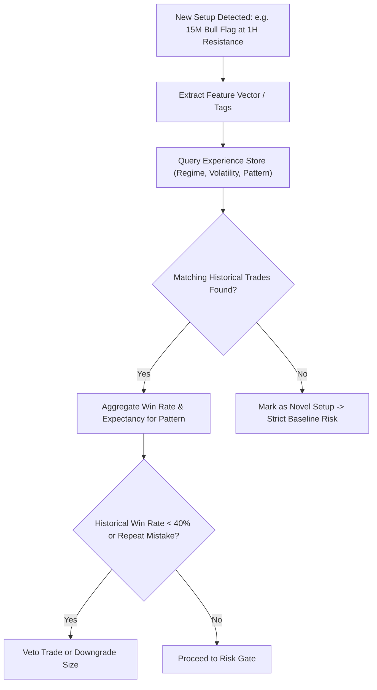

# NIFTY AUTONOMOUS TRADER — MEMORY ARCHITECTURE

**Document:** `docs/MEMORY_ARCHITECTURE.md`  
**Architecture Version:** 1.0.0 (Phase 0 Baseline)  
**Status:** Approved Memory Design  

---

## 1. Dual-Layer Cognitive Memory Architecture

A human trader operates using two distinct forms of memory:
1. **Working Memory (Short-Term):** "What happened over the last 3 hours? Where did price bounce? Is there an active trade running right now?"
2. **Experience Memory (Long-Term):** "The last time we had a gap-up in an overbought 1H regime followed by a tight 15M consolidation, it resulted in a false breakout that trapped buyers. I should be cautious."

The NIFTY Autonomous Trader formalizes this dichotomy into a two-tier memory architecture:

```
┌────────────────────────────────────────────────────────────────────────┐
│                        TRADER MEMORY SYSTEM                            │
├───────────────────────────────────┬────────────────────────────────────┤
│ TIER 1: SHORT-TERM WORKING MEMORY │ TIER 2: LONG-TERM EXPERIENCE STORE │
│ • Current active session context  │ • Permanent trade outcome journal  │
│ • Rolling 5-candle 15M buffer     │ • Mistake & behavioral defect log  │
│ • Active setup watch list         │ • Strategy performance attribution │
│ • Open paper positions & trailing │ • Historical setup similarity index│
│ • Cleared / archived at 15:30 IST │ • Persisted permanently in SQLite  │
└───────────────────────────────────┴────────────────────────────────────┘
```

---

## 2. Tier 1: Short-Term Working Memory

- **Scope:** The current active trading session (08:45 to 15:30 IST).
- **Storage:** In-memory Pydantic state container synced periodically to SQLite `session_state` table for crash recovery.
- **Contents:**
  ```json
  {
    "session_date": "2026-09-28",
    "market_phase": "OPEN",
    "current_1h_regime": "BULLISH_TRENDING",
    "key_intraday_levels": {
      "pdh": 25420.50,
      "pdl": 25210.00,
      "day_high": 25380.20,
      "day_low": 25295.40,
      "vwap": 25340.10
    },
    "recent_observations": [
      {"time": "10:15", "state": "PULLBACK", "action": "WAIT"},
      {"time": "10:30", "state": "REACTION_AT_20EMA", "action": "WATCH_SETUP"}
    ],
    "active_watch_setup": {
      "name": "20EMA_BULL_PULLBACK",
      "trigger_level": 25355.00,
      "invalidation": 25320.00
    },
    "open_position": null
  }
  ```

---

## 3. Tier 2: Long-Term Experience Memory

- **Scope:** Persistent across months and years of trading operations.
- **Storage:** SQLite with Full-Text Search (FTS5) and metadata tagging (`data/experience.db`).
- **Record Taxonomy:**
  1. **Trade Post-Mortems:** Every closed paper trade with planned vs. actual outcome, R:R achieved, and qualitative critique.
  2. **Mistake Tags:** Categorized operational errors:
     - `CHASING_EXTENDED_CANDLE`: Entry initiated when price was > 1.5x ATR away from 20 EMA.
     - `FIGHTING_1H_TREND`: Taking short 15M setups while 1H structure is unambiguously bullish.
     - `PREMATURE_EXIT`: Discretionary exit before stop or target was hit.
  3. **Regime Playbooks:** Summaries of which setups yielded positive expectancy in specific volatility/trend regimes.

---

## 4. Historical Precedent & Similarity Retrieval

Before confirming any prospective `TradePlan`, the agent queries its long-term memory for historical analogues:



### Retrieval Schema Example:
```sql
SELECT 
    setup_name, 
    COUNT(*) as total_trades, 
    SUM(CASE WHEN realized_pnl > 0 THEN 1 ELSE 0 END) * 100.0 / COUNT(*) as win_rate,
    AVG(pnl_percentage) as avg_return,
    GROUP_CONCAT(DISTINCT mistake_tag) as common_pitfalls
FROM historical_trades
WHERE market_regime = :current_1h_regime 
  AND setup_name = :current_setup_name
GROUP BY setup_name;
```

---

## 5. Memory Compaction & Hygiene

To prevent context window bloat and token waste when feeding historical memory to the Model Router:
1. **Never dump raw historical tick data into LLM prompts.**
2. Feed concise **Attribution Summaries** (e.g., *"Historical precedent for 20EMA pullback in Bullish Regime: 14 trades, 64% win rate, avg R:R 1:2.3. Common mistake: Entering before 15M candle closes."*).
3. Weekly background maintenance runs compaction, aggregating individual session logs into macro-level playbook lessons.
