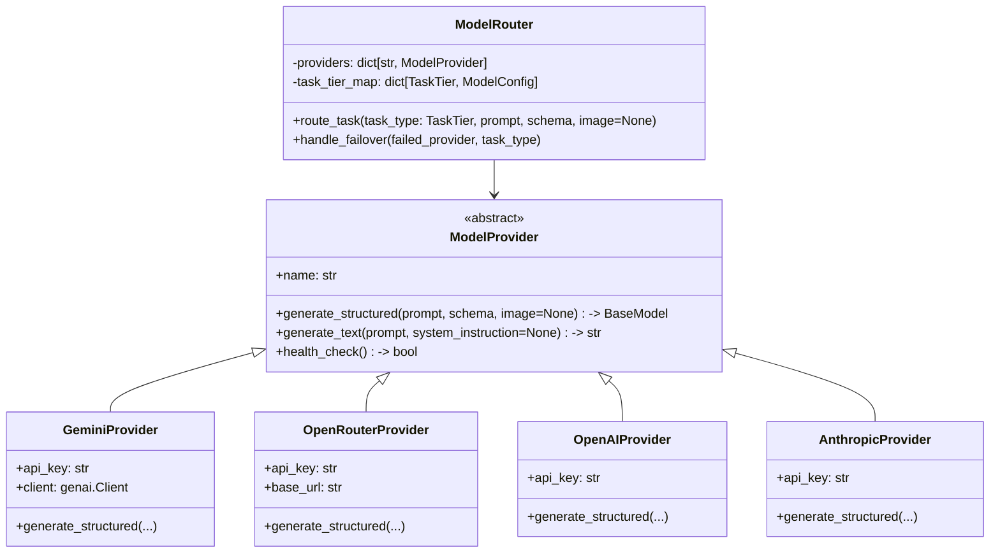
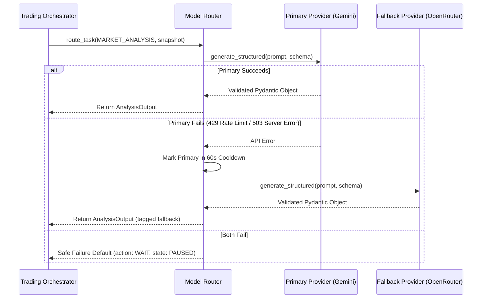

# NIFTY AUTONOMOUS TRADER — MODEL ROUTER ARCHITECTURE

**Document:** `docs/MODEL_ROUTER_ARCHITECTURE.md`  
**Architecture Version:** 1.0.0 (Phase 0 Baseline)  
**Status:** Approved Cognitive Design  

---

## 1. Motivation & Core Objective

The trading system must **never be permanently hardcoded to a single AI vendor** (such as Gemini).

While Gemini is an outstanding multimodal reasoning brain with generous context windows and native vision, future operational requirements may demand:
- OpenRouter for access to bleeding-edge reasoning models (e.g. DeepSeek-R1, Claude 3.7 Sonnet).
- Local models (via Ollama / vLLM) for low-latency or offline privacy.
- Automatic failover if a primary provider encounters HTTP 429 (rate limits) or 503 (outages).

Therefore, the trading application communicates strictly with a **`ModelRouter`** abstraction, decoupling all trading logic from specific LLM SDKs.

---

## 2. Core Abstractions



### 2.1 The `ModelProvider` Abstract Base Class
Every provider adapter implements a standard, uniform interface:
```python
from abc import ABC, abstractmethod
from typing import Type, TypeVar, Optional
from pydantic import BaseModel

T = TypeVar("T", bound=BaseModel)

class ModelProvider(ABC):
    @property
    @abstractmethod
    def provider_name(self) -> str:
        """Unique identifier for the provider (e.g., 'gemini', 'openrouter')."""
        pass

    @abstractmethod
    async def generate_structured(
        self,
        prompt: str,
        response_model: Type[T],
        system_instruction: Optional[str] = None,
        image_bytes: Optional[bytes] = None,
        temperature: float = 0.2
    ) -> T:
        """Enforces guaranteed output matching the specified Pydantic schema."""
        pass

    @abstractmethod
    async def health_check(self) -> bool:
        """Returns True if the provider API is accessible and authenticated."""
        pass
```

---

## 3. Task-Based Model Routing

Different trading sub-tasks require vastly different cognitive trade-offs between speed, cost, multimodal vision, and deep step-by-step reasoning.

| Task Tier | Responsibility | Primary Requirement | Example Model Choices |
|---|---|---|---|
| **`FAST_OBSERVE`** | 15M routine candle observation, state ping, noise filtering | Ultra-low latency, low cost, high reliability | Gemini 2.0 Flash, Claude 3.5 Haiku, GPT-4o-mini |
| **`MARKET_ANALYSIS`** | 1H trend evaluation, multi-level confluence, vision inspection | Native vision, large context, balanced reasoning | Gemini 1.5 Pro / 2.0 Flash, Claude 3.5 Sonnet |
| **`SETUP_CONFIRMATION`** | Detailed 15M trade setup validation & invalidation mapping | High-precision instruction following, zero hallucination | Claude 3.7 Sonnet, Gemini 1.5 Pro, GPT-4o |
| **`RESEARCH`** | Macroeconomic calendar, RBI/Fed statements, sector news | High synthesis speed, web search retrieval grounding | Perplexity API, Gemini with Search grounding |
| **`POST_MORTEM`** | Deep failure analysis of closed paper trades, mistake tagging | Deep chain-of-thought, logical rigor | DeepSeek-R1, Claude 3.7 Thinking, o3-mini |
| **`STRATEGY_IMPROVEMENT`**| Generating hypothesis mutations for laboratory backtests | Creative hypothesis generation, structural coding | Claude 3.7 Sonnet, GPT-4o |

---

## 4. Configuration Schema (`models.yaml`)

Users and operators can configure model preferences in a clean YAML file without editing application code:

```yaml
# ==============================================================================
# NIFTY Autonomous Trader — Model Router Configuration
# ==============================================================================

routing:
  fast_observe:
    provider: gemini
    model: gemini-2.0-flash
    temperature: 0.1
    fallback:
      provider: openrouter
      model: google/gemini-2.0-flash-001

  market_analysis:
    provider: gemini
    model: gemini-1.5-pro
    temperature: 0.2
    fallback:
      provider: openrouter
      model: anthropic/claude-3.5-sonnet

  setup_confirmation:
    provider: gemini
    model: gemini-1.5-pro
    temperature: 0.1
    fallback:
      provider: openrouter
      model: anthropic/claude-3.7-sonnet

  post_mortem:
    provider: openrouter
    model: deepseek/deepseek-r1
    temperature: 0.3
    fallback:
      provider: gemini
      model: gemini-1.5-pro

providers:
  gemini:
    api_key_env: GEMINI_API_KEY
    base_url: https://generativelanguage.googleapis.com/v1beta
    timeout_seconds: 30
    max_retries: 3

  openrouter:
    api_key_env: OPENROUTER_API_KEY
    base_url: https://openrouter.ai/api/v1
    timeout_seconds: 45
    max_retries: 3

  openai:
    api_key_env: OPENAI_API_KEY
    timeout_seconds: 30
    max_retries: 2
```

---

## 5. Resilience, Cooldowns & Fallback Handling



### Key Safety Guarantees:
1. **Never Invent Data on Failure:** If all providers fail, the router returns a predefined safe fallback with `action: "WAIT"` and status `"DATA_UNAVAILABLE"`.
2. **Exponential Backoff with Jitter:** Retries on transient network disconnects without storming the provider API.
3. **Provider Cooldown Latch:** When a provider hits a quota limit (HTTP 429), it is placed on a temporary cooldown (default: 60s) so subsequent candle turns automatically route to the fallback without burning latency.
