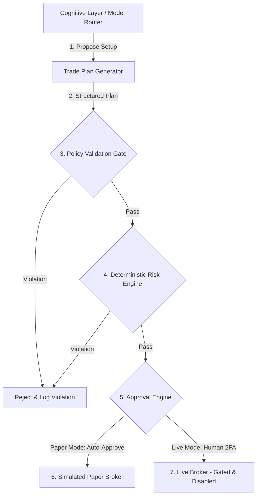

# NIFTY AUTONOMOUS TRADER — SAFETY ARCHITECTURE

**Document:** `docs/SAFETY_ARCHITECTURE.md`  
**Architecture Version:** 1.0.0 (Phase 0 Baseline)  
**Status:** Approved Safety Design  

---

## 1. The Multi-Tiered Safety Gate System

The core design principle of the safety system is **Defense-in-Depth**.

No single component—and specifically **no AI model**—is ever permitted to execute an order without passing through multiple independent, deterministic verification layers:

---

## 2. Deterministic Mathematical Constraints

These constraints are coded as rigid, deterministic Python functions. **They cannot be modified, softened, or bypassed by system prompts, LLM reasoning, or dynamic runtime arguments.**

| Constraint | Strict Policy Value | Enforcement Mechanism |
|---|---|---|
| **Maximum Risk Per Trade** | **≤ 1.0%** of total account equity | Position sizing formula calculates exact lots based on `(Entry - SL)`. If risk exceeds 1%, order is rejected. |
| **Minimum Risk-to-Reward (R:R)** | **≥ 1:2.0** | `(Planned Target - Entry) / (Entry - Planned SL) >= 2.0`. Rejects setups where target is too close or stop is too wide. |
| **Maximum Daily Loss Limit** | **≤ 3.0%** of account equity (or ₹5,000) | If cumulative realized + unrealized loss reaches threshold, **trading is disabled for the remainder of the session**. |
| **Maximum Trades Per Day** | **≤ 3 Trades** per session | Prevents revenge trading, overtrading, or rapid execution loops during choppy sideways markets. |
| **Maximum Concurrent Positions** | **Exactly 1 Position** | Only one active position allowed at any time. No pyramiding or multiple unhedged positions. |
| **Trading Session Time Cutoffs** | • No new entries after **14:30 IST** • Mandatory intraday square-off at **15:15 IST** | Eliminates overnight gap risk and low-liquidity market-close volatility traps. |
| **Minimum Distance to Invalidation** | **≥ 15 NIFTY Points** | Rejects micro-stops that are guaranteed to be triggered by normal market spread and noise. |

---

## 3. Position Sizing Formula

Position sizing is mathematically derived from risk, never arbitrarily guessed:

$$\text{Risk Amount (\₹)} = \text{Account Equity} \times \text{Risk Percentage (e.g. 0.01)}$$

$$\text{Points at Risk} = |\text{Planned Entry Price} - \text{Planned Stop Loss Price}|$$

$$\text{Max Allowed Quantity} = \left\lfloor \frac{\text{Risk Amount}}{\text{Points at Risk} \times \text{Contract Multiplier}} \right\rfloor \times \text{Contract Multiplier}$$

If `Max Allowed Quantity < Contract Lot Size (e.g. 25 shares for NIFTY)`:
- **The trade is immediately rejected.**
- The system will never take a position where even a single minimum lot exceeds the declared 1% risk threshold.

---

## 4. Emergency Kill-Switch & Fail-Safe Mechanisms

### 4.1 System Kill-Switch (`EMERGENCY_STOP`)
- An operator can invoke `nifty-trader kill` or press the UI Emergency Stop button at any moment.
- **Immediate Action:**
  1. Instantly cancels all open pending orders.
  2. Issues market square-off orders for any open positions.
  3. Transitions state machine to `PAUSED`.
  4. Locks database against new order generation until manual reset.

### 4.2 Network & Broker Disconnection Guard
- If heartbeat pings to the market data feed fail for 3 consecutive intervals (45 seconds):
  - State immediately transitions to `PAUSED`.
  - If a position is active, a safety trailing stop is held at the last known stop level.
  - Zero new orders can be created while disconnected.

### 4.3 Paper vs. Live Broker Segregation
- The codebase enforces strict interface segregation:
  - `PaperBroker` inherits from `BaseBroker` but operates on local SQLite balance tables.
  - `LiveBroker` (planned for future packages) is physically isolated in a separate module requiring dedicated API keys, encrypted credentials, and an explicit compile-time flag (`ALLOW_LIVE_TRADING=True`).
- In Phase 0 and Phase 1, the `LiveBroker` class does not exist.
