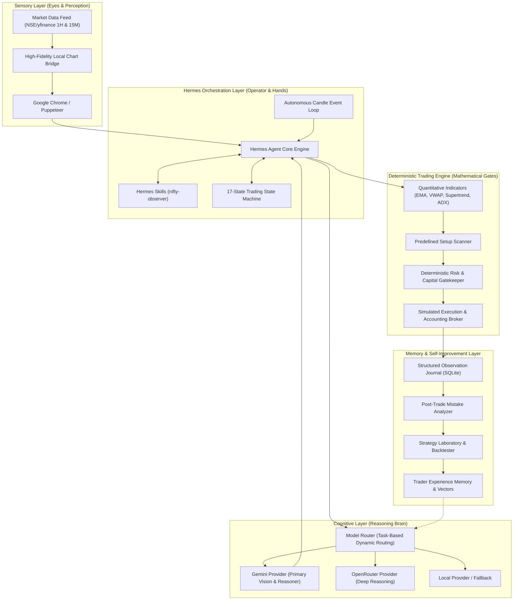

# NIFTY AUTONOMOUS TRADER — SYSTEM ARCHITECTURE

**Document:** `docs/SYSTEM_ARCHITECTURE.md`  
**Architecture Version:** 1.0.0 (Phase 0 Baseline)  
**Status:** Approved System Design  

---

## 1. High-Level System Architecture

The NIFTY Autonomous Trader is architected as a modular, layered software system. It separates cognitive artificial intelligence from deterministic financial math, ensuring maximum reliability, auditability, and safety.



---

## 2. Component Layer Responsibilities

### 2.1 Sensory & Perception Layer
- **Responsibility:** Ingest, structure, and visualize market price action.
- **Components:**
  - `market/feed.py`: Fetches verified 1H and 15M OHLCV candlestick data for NIFTY (`^NSEI`).
  - `browser/chart_server.py`: Serves a local, isolated, and deterministic TradingView Lightweight Charts canvas. Completely immune to third-party captchas, paywalls, and cookie banners.
  - `browser/observer.py`: Uses Chrome via Puppeteer/CDP to capture high-resolution screenshots and evaluate DOM elements for multimodal vision and state extraction.

### 2.2 Hermes Orchestration Layer
- **Responsibility:** Operates the software like a disciplined human trader.
- **Components:**
  - `hermes/skills/nifty-observer/`: A standard Hermes skill governing the observation-to-wait workflow.
  - `state/machine.py`: Deterministic finite-state machine governing operational states.
  - `market/clock.py`: Event-driven candle scheduler aligning analysis strictly to 15M/1H boundaries.

### 2.3 Model Router & Cognitive Layer
- **Responsibility:** Abstract, route, and parse LLM reasoning tasks without vendor lock-in.
- **Components:**
  - `router/model_router.py`: Selects the appropriate model per task tier (Fast, Reasoning, Research, Strategic).
  - `router/providers/`: Pluggable adapters implementing `ModelProvider` for Gemini, OpenRouter, OpenAI, and Anthropic.
  - `gemini/schemas/`: Strict Pydantic models ensuring structured JSON outputs (`MarketSnapshot`, `AnalysisOutput`, `TradePlan`).

### 2.4 Deterministic Trading Engine
- **Responsibility:** Execute quantitative validation and simulated order management.
- **Components:**
  - `engine/indicators.py`: Pure mathematical calculations (EMA 9/21/50/200, Supertrend 10/3, ADX 14, RSI 14, VWAP).
  - `engine/risk_gate.py`: Hardcoded, unbypassable policy validator (Risk ≤ 1% equity, minimum R:R 1:2, max daily loss ₹5,000, max 3 trades/day).
  - `engine/paper_broker.py`: Virtual account management simulating realistic order execution, slippage, and PnL accounting.

### 2.5 Memory & Learning Layer
- **Responsibility:** Record experience and drive controlled, evidence-based improvement.
- **Components:**
  - `memory/journal.py`: SQLite-backed persistent audit log storing every candle snapshot, AI assessment, and trade execution.
  - `learning/post_mortem.py`: Automated analysis comparing planned R:R against actual trade outcomes.
  - `learning/strategy_lab.py`: Isolated simulation environment for evaluating proposed parameter adaptations against historical backtests.

---

## 3. Extension Architecture vs. Destructive Fork

To maintain 100% upgradeability with future upstream Hermes Agent releases, the project adopts an **Out-of-Tree Extension Layer Architecture**:

```
D:\AI_Trading\
├── hermes-agent\                # Pristine upstream repository (git submodule/remote)
│   ├── agent/
│   ├── cli.py
│   ├── run_agent.py
│   └── tools/
│
└── nifty-autonomous-trader\     # Our standalone product codebase
    ├── config/                  # Product-specific configuration
    ├── core/                    # Extension bridge into Hermes agent loop
    ├── router/                  # Model Router abstraction
    ├── browser/                 # Chart observer & Puppeteer bridge
    ├── market/                  # NSE NIFTY market data engine
    ├── engine/                  # Deterministic indicators & Risk Gate
    ├── paper/                   # Simulated Paper Broker
    ├── memory/                  # Observation journal & experience DB
    ├── learning/                # Post-mortem & Strategy Lab
    ├── docs/                    # Architecture & specifications
    └── main.py                  # Standalone application entrypoint
```

### Benefits of Extension Layer:
1. **Zero Upstream Poisoning:** No modifications to upstream Hermes core code.
2. **Seamless Upstream Upgrades:** New Hermes versions can be integrated via standard `git pull` or `git submodule update` without resolving messy merge conflicts in trading logic.
3. **Standalone Distribution:** The product can be packaged, containerized, or installed as a turnkey executable.

---

## 4. Inter-Component Communication Protocols

1. **Market Snapshot Pipeline (Sensory → Cognitive):**
   - Sensory layer creates a typed `MarketSnapshot` (JSON string + optional chart image base64).
   - Injected into Hermes turn context.
2. **Reasoning Pipeline (Cognitive → Orchestration):**
   - Model Router returns a validated `AnalysisOutput` Pydantic object.
   - Orchestrator interprets `action` (`OBSERVE`, `WAIT`, `WATCH_SETUP`, `ANALYZE`).
3. **Trade Execution Pipeline (Cognitive → Deterministic):**
   - If a setup matures into a `TradePlan`, it is submitted to `engine/risk_gate.py`.
   - If all mathematical constraints pass, the plan is dispatched to `engine/paper_broker.py`.
   - If any constraint fails, the trade is rejected and logged in `memory/journal.py` with the exact violation reason.
