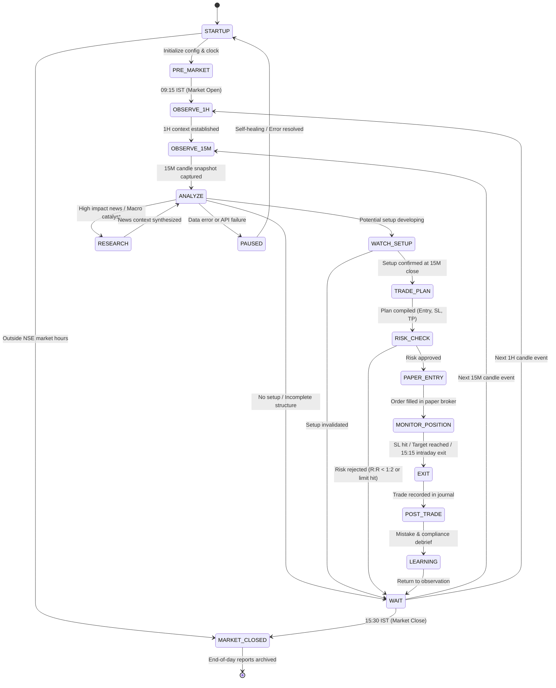

# NIFTY AUTONOMOUS TRADER — TRADING AGENT ARCHITECTURE

**Document:** `docs/TRADING_AGENT_ARCHITECTURE.md`  
**Architecture Version:** 1.0.0 (Phase 0 Baseline)  
**Status:** Approved Agent Architecture  

---

## 1. Multi-Timeframe Trading Model

To replicate a disciplined institutional price-action trader, the software enforces a strict **Dual-Timeframe Hierarchy**:

```
┌────────────────────────────────────────────────────────────────────────┐
│                   DUAL-TIMEFRAME COGNITIVE MODEL                       │
├────────────────────────────────────────────────────────────────────────┤
│ 1-HOUR (1H) TIMEFRAME — "THE REGIME & MACRO COMPASS"                   │
│ • Trend Classification: Bullish | Bearish | Rangebound | Transitional │
│ • Major Market Structure: Multi-day Highs/Lows, Swing Pivots           │
│ • Key Reaction Zones: Major Institutional Support & Resistance         │
│ • Volatility Context: 1H Average True Range (ATR)                      │
│ • Evaluated: On startup, at hourly candle closes, or upon breakouts    │
├────────────────────────────────────────────────────────────────────────┤
│ 15-MINUTE (15M) TIMEFRAME — "THE TACTICAL SETUP & EXECUTION LENS"      │
│ • Local Structure: Higher Highs/Lows vs Lower Highs/Lows               │
│ • Setup Formation: Pullbacks to EMA, Range Breakouts, Fakeout Traps   │
│ • Entry Confirmation: Candlestick rejection, volume surge, close check │
│ • Invalidation (Stop-Loss): Structural swing point on 15M              │
│ • Target (Take-Profit): Next major 1H liquidity zone (min 1:2 R:R)     │
│ • Evaluated: Exactly at every 15-minute candle close                   │
└────────────────────────────────────────────────────────────────────────┘
```

> **Strict Rule:** Timeframes below 15M (such as 5M, 3M, 1M, or raw ticks) are completely prohibited in initial phases to avoid micro-noise, overtrading, and excessive API burn.

---

## 2. Complete Finite State Machine (FSM)

The system transitions deterministically between predefined operational states:



---

## 3. Operational State Definitions

| State | Purpose & Action | Trigger to Exit |
|---|---|---|
| **`STARTUP`** | Loads configuration, verifies API keys, runs tool health checks, recovers persistent state from SQLite. | System healthy → `PRE_MARKET` or `MARKET_CLOSED`. |
| **`PRE_MARKET`** | Operates between 08:45 and 09:15 IST. Fetches GIFT NIFTY, global indices, and overnight news headlines. | Time = 09:15 IST → `OBSERVE_1H`. |
| **`OBSERVE_1H`** | Downloads 1H candles, opens 1H chart, identifies primary trend, draws key swing levels. | 1H context built → `OBSERVE_15M`. |
| **`OBSERVE_15M`** | Downloads 15M candles, opens 15M chart, captures visual snapshot, computes short-term indicators. | Snapshot ready → `ANALYZE`. |
| **`ANALYZE`** | Dispatches structured market snapshot to Model Router. Solicits structured reasoning and action recommendation. | LLM returns parsed `AnalysisOutput`. |
| **`WAIT`** | **The default state.** Enters deep non-blocking sleep until the next scheduled candle boundary or system interrupt. | Next 15M candle close event. |
| **`WATCH_SETUP`** | A valid setup pattern is forming (e.g. pullback approaching 20 EMA). Monitors proximity to trigger level. | Candle confirms trigger → `TRADE_PLAN` (or invalidates → `WAIT`). |
| **`RESEARCH`** | Queries web/news tools for contextual clarity if unexpected high volatility or macro event occurs. | Research compiled → `ANALYZE`. |
| **`TRADE_PLAN`** | Formalizes precise entry price, invalidation level (Stop-Loss), and minimum 1:2 Take-Profit level. | Dispatches plan to `RISK_CHECK`. |
| **`RISK_CHECK`** | Deterministic mathematical validation: Checks position size, account risk, max daily drawdown, and minimum R:R. | Passes → `PAPER_ENTRY`; Fails → `WAIT`. |
| **`PAPER_ENTRY`** | Generates simulated limit/market order via Paper Broker, applies slippage model, records fill in journal. | Order confirmed → `MONITOR_POSITION`. |
| **`MONITOR_POSITION`** | Actively trails stop-loss at 15M candle closes. Enforces hard intraday square-off at 15:15 IST. | Stop hit / Target hit / 15:15 cutoff → `EXIT`. |
| **`EXIT`** | Calculates realized PnL, cancels pending orders, records execution metrics in journal. | Position closed → `POST_TRADE`. |
| **`POST_TRADE`** | Conducts automated post-mortem comparing trade outcome against initial plan and R:R thesis. | Debrief logged → `LEARNING`. |
| **`LEARNING`** | Flags behavioral errors (e.g., chasing, late entry), updates experience memory, logs hypothesis to Strategy Lab. | Complete → `WAIT`. |
| **`PAUSED`** | Safe latch engaged upon network failure, missing data, or provider quota exhaustion. Zero trade risk. | Health check passes → resumes previous state. |
| **`MARKET_CLOSED`** | Engaged after 15:30 IST. Compiles daily performance journal, computes session Sharpe/drawdown, enters standby. | Next day 08:45 IST → `PRE_MARKET`. |

---

## 4. The Event-Driven Candle Clock

The system does **NOT run a busy while-true polling loop** that spikes CPU and exhausts API credits.

Instead, the `MarketClock` operates as an asynchronous, event-driven cron:
- Indian Standard Time (IST = UTC + 5:30).
- Market Trading Hours: `09:15` to `15:30` IST (Monday through Friday).
- **15M Candle Boundaries:**
  `09:30`, `09:45`, `10:00`, `10:15`, `10:30`, `10:45`, `11:00`, `11:15`, `11:30`, `11:45`, `12:00`, `12:15`, `12:30`, `12:45`, `13:00`, `13:15`, `13:30`, `13:45`, `14:00`, `14:15`, `14:30`, `14:45`, `15:00`, `15:15`, `15:30`.
- **Sleeping Mechanism:**
  Upon entering `WAIT` at timestamp `T`, the clock calculates `seconds_until_next_boundary = next_candle_time - T + grace_seconds (5s)`. The agent executes an asynchronous `asyncio.sleep()` and awakens precisely when the new candle data is finalized.
